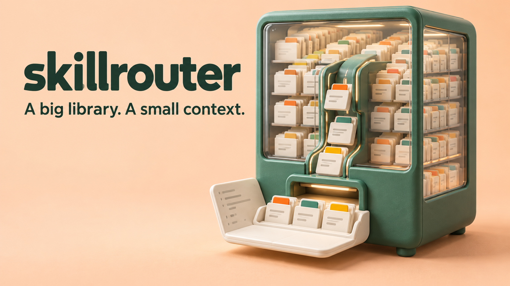
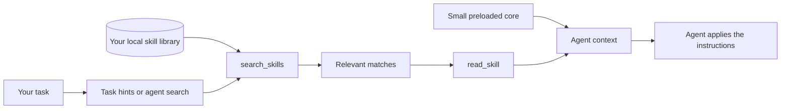

# skillrouter

**A big library. A small context.**



Keep your skills. Give your agent the right ones for the task.

Skillrouter organizes local `SKILL.md` folders into a small **core** that stays available and a larger **library** searched on demand through two MCP tools: `search_skills` and `read_skill`. Hooks can suggest relevant skills before and during work; usage reports help you tune what stays in core.

**Start here:** [Let your agent install it](#let-your-agent-install-it) · [Manual setup](#manual-quick-start) · [Host support](#agent-support) · [Troubleshooting](docs/TROUBLESHOOTING.md)

> **Release status:** this checkout documents **0.2.0-beta.1**, a beta that is not published to npm. Use a checkout of this repository; a marketplace listing, if you find one, may hold an earlier version. Do not use `npx skillrouter` to install it. See [validation and release limits](#validation-and-release-status).

## Why this exists

Collecting skills is easy. Making them useful across agents is harder. A large startup catalogue can occupy context, bury useful descriptions, and leave the model choosing from names alone.

Skillrouter gives that catalogue a retrieval step:

| Keep available | Retrieve when needed |
| --- | --- |
| A small core of frequently useful skills | The rest of your local library |
| Selected by you and informed by usage | Selected from the current task |
| Loaded through the host's skill system | Searched and read through MCP |

Installing the router alone does **not** reduce an existing host's preload. That happens when you deliberately choose a core and trim the remaining folders. [Library management and recovery](docs/REFERENCE.md#core-trim-and-recovery) explain that separate step.

The project ships the router and its routing skill, **not a bundle of thousands of third-party skills**. Evaluation skills are synthetic test fixtures. Bring your own library and retain its licenses.

## Let your agent install it

Copy this entire prompt into a coding agent with access to your local terminal and files. It handles setup, preserves existing settings, and checks the result. Cloud-only chat apps need a supported local connection; a prompt cannot grant filesystem access.

```text
Install and verify Skillrouter for me from:
https://github.com/404kidwiz/skillrouter

Use the current agent as the initial target. If you cannot identify the host,
ask me which host to configure. Configure additional hosts only if I name them.

1. Inspect first:
Read applicable local instructions and the repository README, docs/INSTALL.md
and docs/SUPPORT.md. Detect OS, shell, Git, Node and npm. Use a stable checkout
location, reuse an existing checkout when appropriate, and preserve local edits.
Report the selected commit/version. Do not assume an unpublished candidate is
available on the default branch or npm. If the documented release files are
missing, explain the version mismatch instead of inventing installation steps.

2. Install:
Follow the selected checkout's instructions. For the documented candidate,
require Node 20+, built dist files, and npm-shrinkwrap.json, then run:
npm ci --omit=dev --omit=optional --ignore-scripts
Do not use npx skillrouter. Inspect existing host configuration and make a
timestamped backup before modifications. Choose one integration route per host
so a plugin and standalone installation do not duplicate hooks or MCP servers.

3. Connect:
Run the CLI from its stable absolute path. Run doctor and index. Include the
checkout's skills directory as an explicit index root so its routing skill is
available even if my library is empty. Install only the selected supported
host target. Preserve unrelated settings, permissions, models and credentials.
For MCP-only hosts, add a clearly marked routing instruction to the host's
documented user-level instruction mechanism, preserving existing text:
before non-trivial work, search relevant skills and read matching instructions;
follow host permissions and use only skills relevant to the task.
The installer itself does not write this standing instruction.

4. Verify:
Run doctor --live for the selected host and inspect its output, not only its
exit code. Confirm search_skills and read_skill appear. Search for a skill in
my index and read its actual body through the host's MCP tools when available.
If tools require a reload or trust prompt, give me the exact next action.
Separate "configured", "MCP connected", and "agent used a skill"; do not claim
automatic use until observed in a normal task and a fresh session.

5. Finish:
Report version, installation path, changed files, backup paths, indexed count,
checks passed, and anything blocked. Show proposed core/trim changes as a
dry run only. Do not move/delete my skills, run trim --apply or core sync,
install extra skill packs, download optional embedding models, change billing,
weaken approvals, publish a tunnel, or send private files elsewhere.
```

The prompt gets the router connected **before** reorganizing your library. Decide what to move after seeing a dry run.

## Manual quick start

**Prerequisites:** Git, Node **20+**, npm, and a local host supporting the chosen integration. Keep the checkout in a permanent location; installed configurations pin its absolute CLI path.

Clone into a new directory, or use your existing candidate checkout:

```sh
git clone https://github.com/404kidwiz/skillrouter.git
cd skillrouter
node --version
node -p "require('./package.json').version"
```

Check that this version's `npm-shrinkwrap.json` and `dist/src/cli.js` exist. If you cloned an older release, follow that release's README or obtain the intended candidate revision. These commands do not fetch an unpublished version.

```sh
npm ci --omit=dev --omit=optional --ignore-scripts
node dist/src/cli.js doctor
node dist/src/cli.js index --root "./skills"
node dist/src/cli.js search "manage trim audit skill library"
```

The explicit root includes the router's own skill. Default roots also include existing supported agent skill folders. An otherwise empty library can complete this first search without installing a skill pack.

**Example: configure Claude Code using the standalone route.** Replace `claude` with your selected target from the table below.

```sh
node dist/src/cli.js install claude
node dist/src/cli.js doctor --live claude
```

Look for `connected` and both tool names. Restart/reload the host and complete its normal trust prompts. In a fresh session, ask a task relevant to an indexed skill and inspect whether the agent searches and reads it.

For multiple hosts, pass explicit targets together, such as `install codex cursor opencode`. [Detailed installation](docs/INSTALL.md) covers Windows, the plugin alternative, MCP-only hosts, standing rules, upgrades and removal.

## How it works



The illustration is a metaphor; this diagram is the workflow. Search returns IDs and descriptions. A body enters the agent's context when the agent reads it. Hints encourage that decision; they do not prove the agent applied the skill.

| Capability | What you get |
| --- | --- |
| Task-driven discovery | Short search phrases instead of browsing thousands of names |
| Core + library | A deliberate preload budget, with the rest available on demand |
| Hooks and standing rules | A reminder to look for relevant instructions at useful moments |
| Search gate | On a task turn the first edit or command is held until the agent has searched the library once (Claude Code, Codex, Cursor, Gemini). Used in real sessions on Claude Code and Codex only; Cursor and Gemini are covered by scripted checks. Codex asks you to trust the hook once |
| Usage and evaluation | Evidence for tuning routing and choosing your core |
| Backed-up trimming | Preview changes, preserve archives, and restore what trim removed, skill by skill |

For ranking, semantic gates, action triggers, session correlation and service internals, read [How Skillrouter works](docs/ARCHITECTURE.md).

## Agent support

These rows describe the repository's adapters. A configured adapter is not proof that every host version or platform has passed native acceptance.

| Agent | Install target | Adapter installs | Important limit |
| --- | --- | --- | --- |
| Claude Code | `claude` | MCP + prompt/tool/stop hooks + search gate | Choose standalone or plugin; preserve normal trust |
| Codex | `codex` | MCP + prompt/tool/stop hooks + search gate | Activation depends on host support and trust; each new hook needs trusting once |
| Cursor | `cursor` | MCP + prompt/tool/stop hooks + search gate | Prompt and stop behavior is for interactive sessions |
| Gemini CLI | `gemini` | MCP + agent/tool hooks + search gate | Final nudge can cause a response retry |
| OpenCode | `opencode` | MCP + message/tool plugin | No final decision nudge |
| Antigravity | `antigravity` | MCP at the current config path | Add a standing routing rule separately |
| OpenClaude | `openclaude` | MCP | Add a standing routing rule separately |
| Hermes | `hermes` | MCP through its configuration API | Installation layout/profile matters; add routing instructions separately |

**macOS, Linux and Windows are implementation targets.** CI runs the tests on all three with Node 20 and 22 (green for the latest commit). Day-to-day use so far has been on two Macs; native Windows acceptance is still open. See the [support matrix](docs/SUPPORT.md).

Grok, Muse and other cloud assistants do not have universal adapters here. They need a host-specific, authorized bridge; local filesystem paths are not remotely accessible by default.

## Everyday commands

These examples run from the checkout and require no global CLI installation.

| Task | Command |
| --- | --- |
| Inspect configuration and index | `node dist/src/cli.js doctor` |
| Reindex after skills change | `node dist/src/cli.js index` |
| Find a skill | `node dist/src/cli.js search "python async testing"` |
| See observed usage | `node dist/src/cli.js report 7` |
| Preview library trimming | `node dist/src/cli.js trim claude` |

Use the [complete reference](docs/REFERENCE.md) for core selection, restore, custom roots, MCP arguments, service controls, environment settings and evaluation.

## Privacy and trust

Search and indexing run locally by default. No embedding-model download is required for lexical search. Optional semantic indexing installs extra dependencies and downloads a model.

`usage.jsonl` records events and **agent-written search queries**. Hook records omit raw prompt text, but that does not make all logs non-sensitive. The index contains local paths and skill metadata; recovery manifests contain original paths. Keep state and backups private.

When a host calls `read_skill`, that body becomes available to the host and its model provider under the host's data policy. Local storage is not a promise that your model never receives the content.

Skills are instructions, not a trust boundary. Review third-party skills and preserve host permissions. The router does not grant permission to execute a skill's commands.

## Validation and release status

For **0.2.0-beta.1**, recorded on 2026-10-25:

| Check | Recorded result |
| --- | --- |
| Full suite, macOS / Node 22 | 237 passed, 0 failed, 8 Windows-only skips |
| CI, latest commit | Linux, macOS and Windows on Node 20 and 22: all six jobs green |
| Real npm archive + clean source-plugin smoke | Both passed (macOS, Node 22 and Node 26) |
| Lexical fixture, 59 prompts | 91% top-1, 98% top-3; 89% hint recall, 91% precision |
| Negative fixture, 12 prompts | 0 false hints |
| 245 real prompts from the author's two Macs | Right skill first 87%, in the top three 97%; hint recall 72%, hint precision 63%; hints on 32% of the prompts that need no skill |

The 245 prompts are labeled by the author after seeing the router's top candidates, so recall is optimistic; 80 of the 177 no-skill prompts were chosen because they look like skill prompts, so 32% is a stress figure rather than the everyday rate. On all of the author's recent task prompts the router showed hints on about 30%. The search gate has about a day of real use, on Claude Code and Codex.

These are dated results, not a live CI badge or a guarantee for arbitrary tasks. Smoke tests cover two-tool MCP behavior, six generated host configurations and byte-exact recovery. They do not prove six native agents automatically use skills.

Native Windows acceptance, an actual Claude marketplace-install check, and real sessions of Cursor, Gemini and OpenCode with the search gate remain open. See [release validation](docs/RELEASING.md) and [compatibility evidence](docs/SUPPORT.md).

## Documentation

| I want to… | Read |
| --- | --- |
| Install, connect, upgrade or remove an integration | [Installation guide](docs/INSTALL.md) |
| Manage the library, recover a trim or configure MCP | [Command and configuration reference](docs/REFERENCE.md) |
| Fix missing tools, stale matches or hook problems | [Troubleshooting and FAQ](docs/TROUBLESHOOTING.md) |
| Understand internals and host support | [Architecture](docs/ARCHITECTURE.md) · [Support matrix](docs/SUPPORT.md) |
| Contribute or prepare a release | [Contributing](CONTRIBUTING.md) · [Release guide](docs/RELEASING.md) · [Changelog](CHANGELOG.md) |

## Contributing

Use pnpm for development; the npm shrinkwrap supports distribution installs.

```sh
pnpm install --frozen-lockfile
pnpm test
npm run smoke:release
```

Smoke tests download production dependencies into disposable installations and do not edit real host settings. Match verification to the change: docs need content/link checks; routing, recovery and host changes need behavioral tests.

[Open an issue](https://github.com/404kidwiz/skillrouter/issues) with the version, OS, Node version, target host, sanitized reproduction and expected behavior. Review private indexes, logs, credentials and skill bodies before sharing anything.

## License

[MIT](LICENSE) for this repository. Individual skill libraries retain their own licenses. Hero artwork was generated for this project; [asset source and prompt](docs/assets/README.md).
